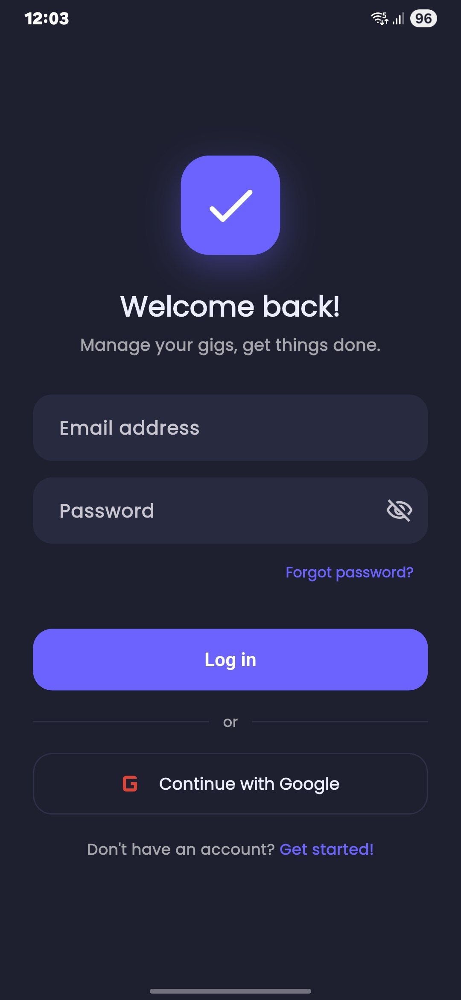
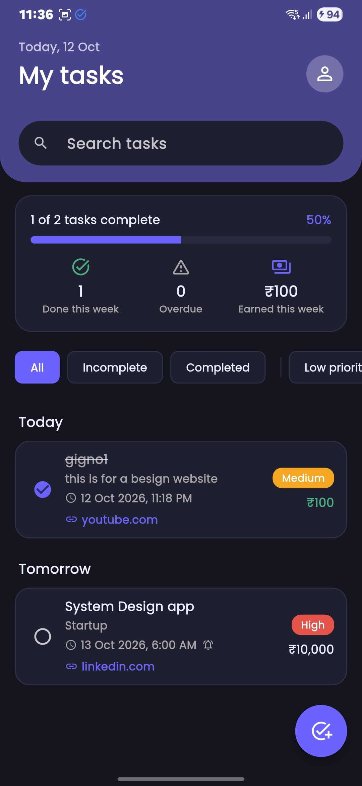
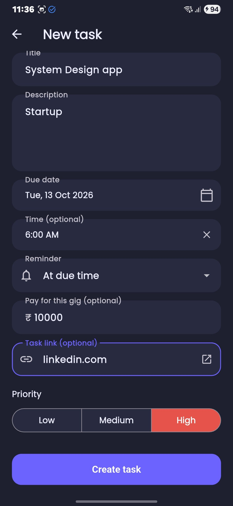
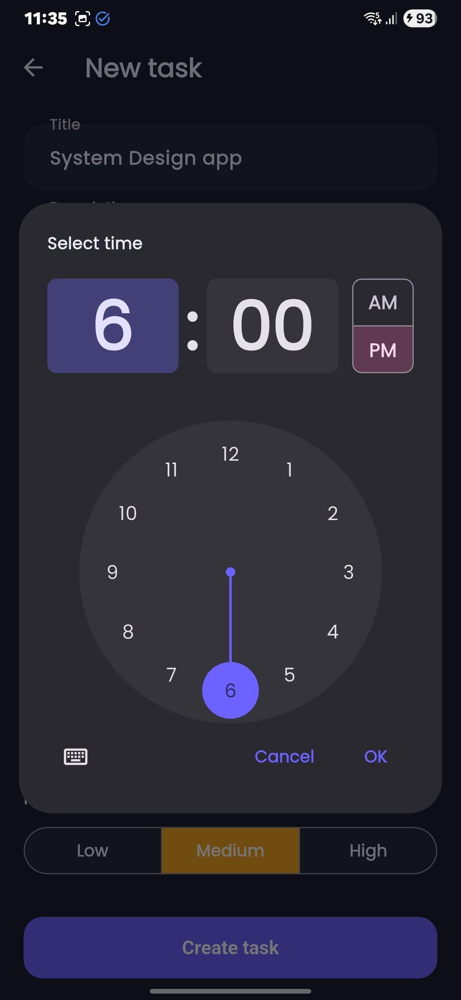
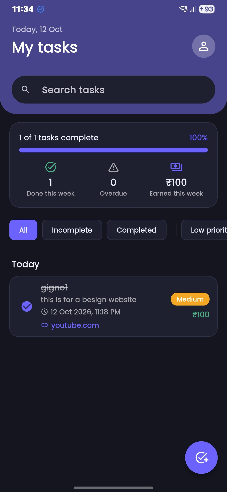
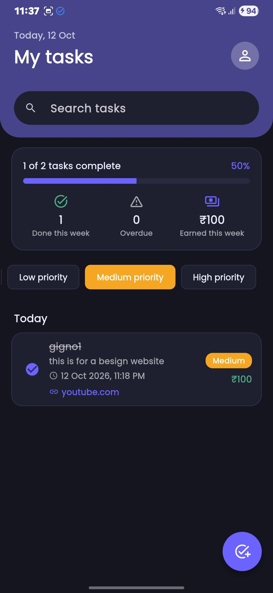

# GigTasks

A task manager for gig workers, built with **Flutter**, **Firebase Authentication** and **Cloud Firestore**.
Create, edit, delete and complete tasks, filter and search them, and get reminders on time.

Built for the Whatbytes Flutter Developer Intern assignment.

<p align="center">
  
  
  
  
</p>
<p align="center">
  
  
</p>

*Dark theme shown. The app also has a light theme and follows the phone's setting, with a manual toggle.*

---

## Features

### Required by the assignment
| Requirement | How it is done |
|---|---|
| Register and log in with email and password | Firebase Authentication |
| Clear errors for invalid credentials | Firebase error codes mapped to readable messages ("Incorrect email or password.") |
| Create, edit, delete, view tasks | Fields: **title, description, due date, priority** (low / medium / high) |
| Tasks stored on a backend | Cloud Firestore, private to each user |
| Mark complete / incomplete | Tick the circle on a task |
| Filter by priority and status | Filter chips: All / Incomplete / Completed and Low / Medium / High |
| List sorted by due date, earliest first | Sorted in the app, and the Firestore query is ordered by due date |
| Clean Material UI for Android and iOS | Material 3, `SafeArea`, adaptive widgets, responsive layout |

### Extras
- **Google sign-in** (Android and web) alongside email and password
- **Unique usernames** with a live available / taken check; shown as `@username` after login
- **Forgot password** (reset email) and **change password**
- **Reminders** as local notifications, with an optional due time and a choice of when to remind you (at due time, 15 min, 1 hour, 1 day before). They fire on the exact minute.
- **Search** by title or description
- **Grouped list**: Overdue, Today, Tomorrow, This week, Later, Earlier
- **Stats**: progress bar, tasks done this week, overdue count, and earnings this week
- **Pay amount** per gig (optional) and a **task link** (job post, brief or map) that opens in the browser
- **Delete** with a trash button on each task, swipe-to-delete, or from the edit screen, always with **Undo**
- **Dark mode**

---

## Tech stack

| | |
|---|---|
| App | Flutter 3.35, Dart 3.9, Material 3 |
| Auth | `firebase_auth`, `google_sign_in` |
| Database | `cloud_firestore` |
| Reminders | `flutter_local_notifications`, `timezone`, `flutter_timezone` |
| Other | `url_launcher`, `shared_preferences`, `intl`, `google_fonts` |

State is handled with plain Flutter (`StatefulWidget`, `StreamBuilder`, `ValueNotifier`). The app is small enough that a state-management library would add complexity without a benefit.

---

## Getting started

**You need:** Flutter 3.35 or newer, and for Android a JDK 17 and the Android SDK.

```bash
git clone <this-repo-url>
cd <repo-folder>
flutter pub get
flutter run                    # a connected Android phone or emulator
flutter run -d chrome          # or the web version
```

The Firebase configuration (`lib/firebase_options.dart` and `android/app/google-services.json`) is included, so the app runs against the project's Firebase straight away. These keys only identify the project; access to data is protected by the security rules in `firestore.rules`.

### Using your own Firebase project
1. Create a Firebase project and enable **Authentication** (Email/Password, and Google if wanted) and **Cloud Firestore**.
2. Run `flutterfire configure` to regenerate the config files.
3. Deploy the security rules: `firebase deploy --only firestore:rules --project <your-project-id>`.
4. For Google sign-in on Android, add your signing fingerprints in the Firebase console (see below) and download a fresh `google-services.json`.

### Google sign-in on Android: please read
Google sign-in only works for builds whose signing-key fingerprint is registered in Firebase. The author's debug key is registered; **your machine's debug key will not be**, so on your own build the Google button will probably show *"Google sign-in isn't set up for this build."* **Email and password work everywhere.** To enable Google sign-in on your build:

```bash
keytool -list -v -alias androiddebugkey -keystore ~/.android/debug.keystore -storepass android -keypass android
```
Add the SHA-1 and SHA-256 under *Firebase console, Project settings, your Android app*, then re-download `google-services.json`.

---

## How it works

- **Live data.** The task list listens to a Firestore stream. Any add, edit, delete or tick updates the screen by itself; there is no refresh code.
- **Auth routing.** The app watches the Firebase auth stream. Logged out shows the login screen; logged in shows the tasks. There is no manual navigation, and the session survives restarts.
- **Private data.** Tasks live at `users/{uid}/tasks/{taskId}`. The rules only let a signed-in user read or write their own.
- **Unique usernames.** Each name is a document `usernames/{lowercase-name}`. The rules allow *creating* it only if it doesn't exist and never allow update or delete, and sign-up claims it atomically with the profile. The rules were tested against the live project (collisions, impersonation, privacy).
- **Reminders.** Whenever the task list changes, all reminders are cancelled and rescheduled from the current tasks, so they always match the data. Tasks with a time remind at that time; date-only tasks remind at 9:00 AM on the day.

The full walkthrough, with what triggers what and the reasoning behind each choice, is in **[docs/HOW_IT_WORKS.md](docs/HOW_IT_WORKS.md)**.

### Project structure
```
lib/
  main.dart                 App start and login routing
  theme.dart                Light / dark themes
  models/                   Task, grouping and stats, reminder planning
  services/                 Auth, Firestore tasks, notifications
  screens/                  Login, home, task form, username, change password
  widgets/                  Task card, stats strip, username field
  utils/link.dart           Link validation
test/                       22 automated tests
firestore.rules             Database security rules
docs/                       Architecture notes and screenshots
```

---

## Tests

```bash
flutter analyze
flutter test
```
22 tests cover the reminder, grouping, stats, overdue, username and link logic, plus widget tests on the real screens (editing an overdue task, delete buttons and Undo).

---

## Platforms and known limitations

- **Tested:** an Android phone (Android 15) and Chrome.
- **iOS:** the code is cross-platform and the iOS app is registered in Firebase, but I develop on Windows and **could not build or run it** (that needs a Mac with Xcode). Google sign-in is not configured for iOS.
- **Notifications** are local, so they work on Android and iOS but not on web. Tapping one opens the app but doesn't jump to the task. iOS keeps only the 64 soonest pending notifications, so the app schedules the 60 soonest.
- **Google sign-in** on a new machine needs its signing fingerprint registered (see above).
- Login is by email, not by username.

## Ideas for next
Open the task from a notification, push notifications via FCM, multiple links per task, categories and tags, recurring tasks, and an iOS build and test.
